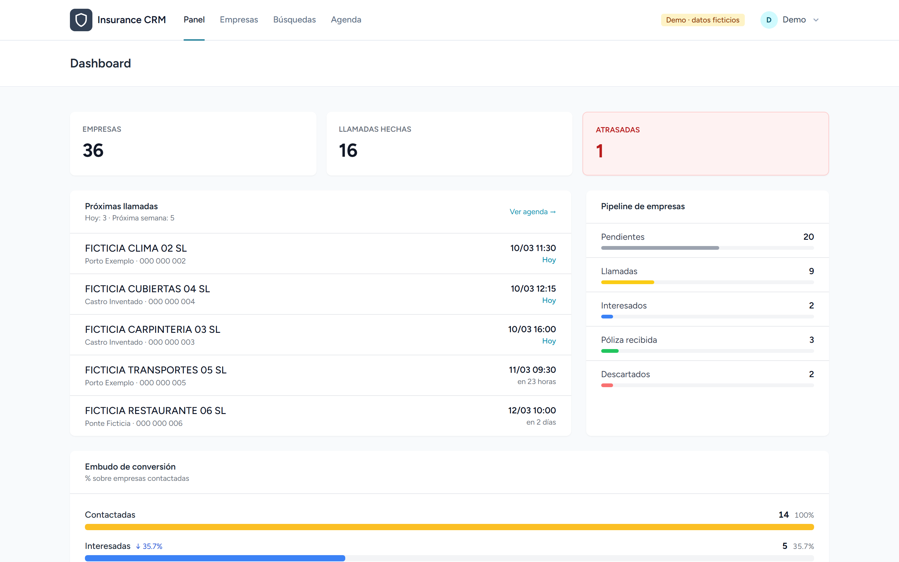
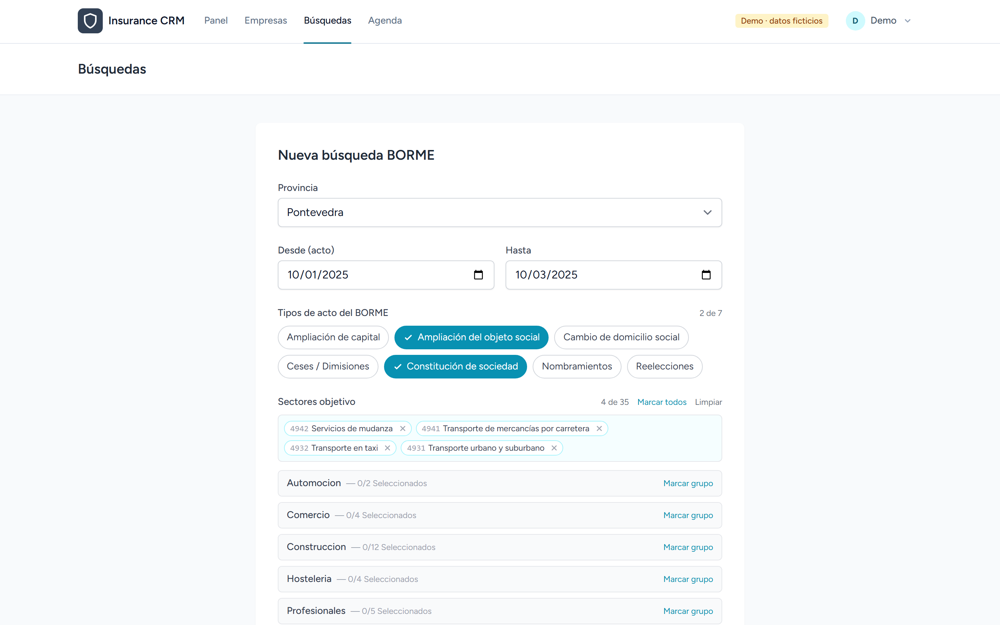
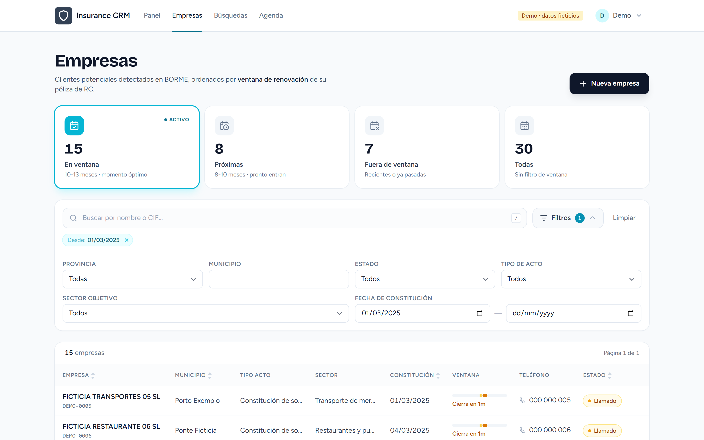
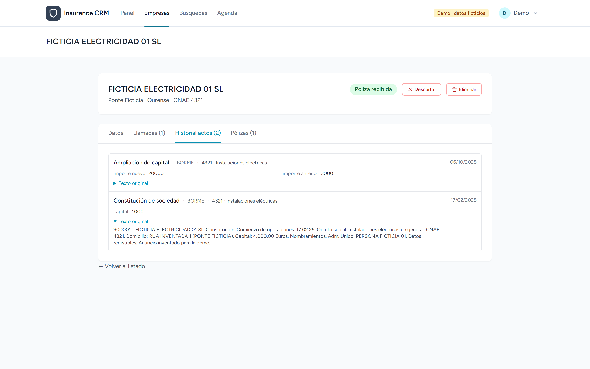
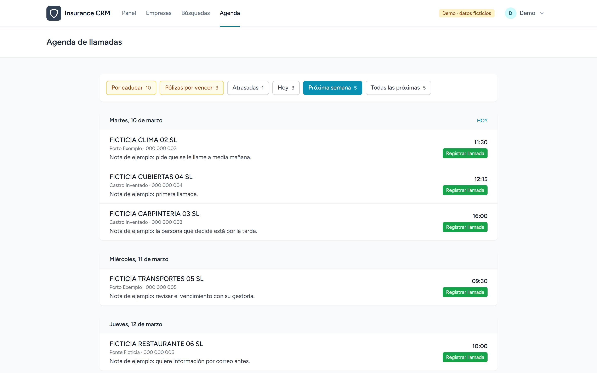
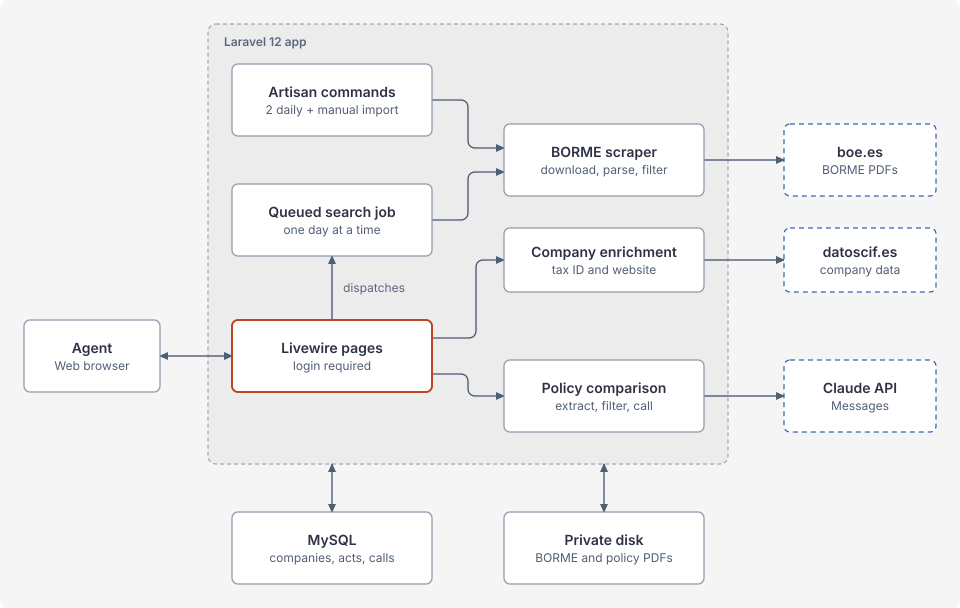
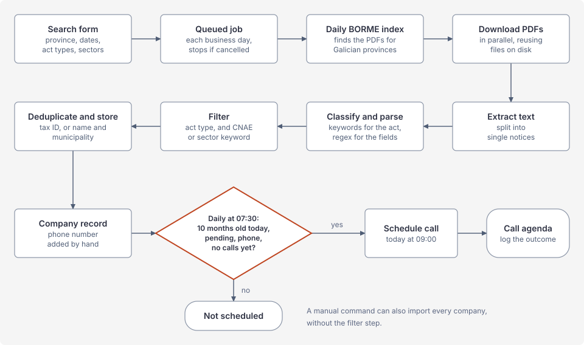
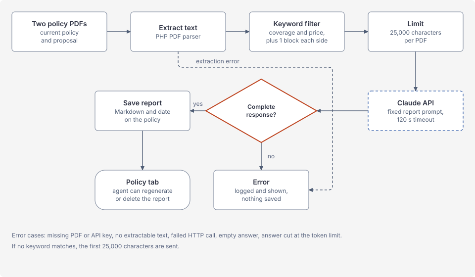
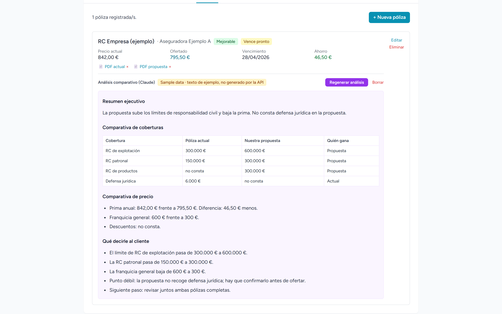
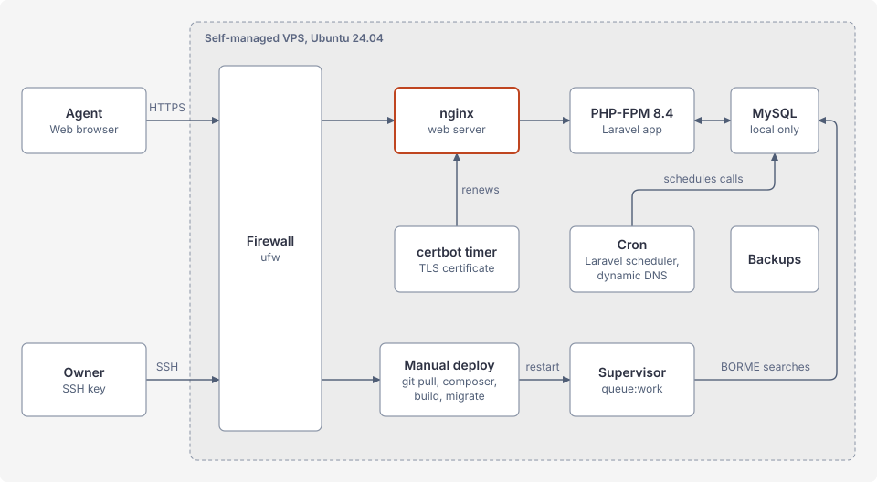

# Insurance CRM

A CRM for an insurance agent in Galicia, Spain, that turns public company notices into a dated list of calls.

All data in the screenshots is fictional. The interface is in Spanish.

## The problem

The app assumes that a new company's first liability policy usually comes up for renewal about a year after the company is formed.

Spain publishes company formations in the BORME, the official gazette of the commercial registry. The notices come as PDFs, one per province and day. Following them by hand means reading every PDF and remembering whom to call ten months later.

## What it does

- **Searches the BORME.** The agent picks a Galician province, a date range, act types and business sectors. A queued job does the work and can be cancelled.
- **Sorts companies by renewal window.** In the window means 10 to 13 months since formation. Upcoming means 8 to 10.
- **Keeps a record per company.** Contact details, registry acts with the original text, call history and policies.
- **Schedules calls.** Two daily commands add a call when a company turns 10 months old, or when a policy is 60 days from expiry.
- **Compares two policies.** The agent uploads the current policy and a proposal, and asks for a written comparison.

| | |
| --- | --- |
|  |  |
|  |  |

## Architecture

Laravel 12, Livewire 4, Tailwind CSS 3 and MySQL 8. PDF text comes from `smalot/pdfparser`.

<picture>
  <source media="(prefers-color-scheme: dark)" srcset="diagrams/architecture-dark.svg">
  
</picture>

The path from a notice to a call:

<picture>
  <source media="(prefers-color-scheme: dark)" srcset="diagrams/borme-to-call-dark.svg">
  
</picture>

## AI policy comparison

<picture>
  <source media="(prefers-color-scheme: dark)" srcset="diagrams/ai-comparison-dark.svg">
  
</picture>

**Before sending.** The app extracts the text of both PDFs and keeps the paragraphs that mention coverage, price or exclusions, plus one before and one after each match. If the PDF has no usable paragraphs, it filters by sentence. Each document is cut at 25,000 characters.

**What leaves the app.** Those fragments and the name of the current insurer go to the Claude API. If no keyword matches, the start of the document is sent instead. The text is not anonymised, so it can include personal data.

**What the prompt asks for.** Four sections: summary, coverage table, price and points for the client. The model must write "no consta" (not stated) when a fact is missing from the fragments.

**Scope.** The report covers coverage and price, based on the selected text. Other clauses are not assessed, and PDFs must contain text.

**Errors.** A missing file or key, an unreadable PDF, a failed call, an empty answer or an answer cut at the token limit shows an error, and no report is saved.

**Human review.** The report is a draft for the agent, who must check every amount and exclusion against both full policies before using it with a client.

*Sample data. This report was written as an example. It is not an API response.*

## Key decisions and trade-offs

| Decision | Why | Cost |
| --- | --- | --- |
| Acts are stored apart from companies | One company can have many notices over time | More joins in the list and filters |
| Act types and sectors live in tables with keywords | Rules can change without editing the parser's matching code | Keyword lists need tuning over time |
| A search runs as a queued job, day by day | A long range does not block the page and can be cancelled | Needs a queue worker |
| Phone numbers are added by hand, with search links | The sources considered block server requests or lack the number | One manual step per company |
| Policy text is filtered before the API call | Less text to send, focused on coverage and price | The agent still reads the full policies |
| Reports render as Markdown with links and images removed | The text derives from third-party PDFs | Links in a report are lost |

## DevOps

The demo environment runs in Docker and is defined as code.

- **Build:** a multi-stage Dockerfile installs the PHP dependencies, builds the Vite assets and copies the result into the app image. The build context leaves out environment files, stored files and database dumps.
- **Services:** Docker Compose starts MySQL, the app and a small TCP gateway. Health checks set the start order. The app exposes `/up` for this.
- **Network isolation:** the app and the database sit on an internal network without internet access. Only the gateway publishes a port, and only on localhost.
- **Disposable data:** the demo database lives in memory. Each start generates a new app key, runs all migrations and loads fictional data from a fixed seed.
- **Seeder guard:** the demo seeder stops unless the environment is local, demo mode is on, the database is the demo one and it is empty.
- **Screenshots:** one Playwright script starts the stack, logs in, captures the six screens and shuts the stack down. It fails on external requests, console errors or HTTP errors.
- **Background work:** searches need a Laravel queue worker. Call scheduling needs the Laravel scheduler, which runs two commands each day.

The app was previously deployed on a self-managed Ubuntu VPS with nginx, PHP-FPM, MySQL, a firewall, SSH key access and backups. Cron ran the Laravel scheduler and Supervisor kept the queue worker running. Releases were manual over SSH: `git pull`, `composer install --no-dev`, asset build, migrations, configuration cache and a queue restart.

<picture>
  <source media="(prefers-color-scheme: dark)" srcset="diagrams/vps-deployment-dark.svg">
  
</picture>

## Testing

On 24 November 2026 the suite ran on PHP 8.4 and MySQL 8.0, in containers without internet access: **128 tests passed, 0 failed, 364 assertions**. Three runs gave the same result. That count is for the main version, before the changes made for this demo.

The suite covers the notice parser, search job, filters, agenda, call scheduling, policy files and the comparison screen with a mocked service.
